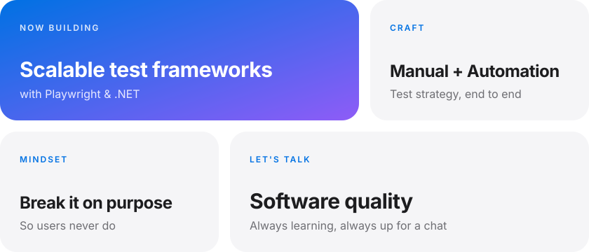
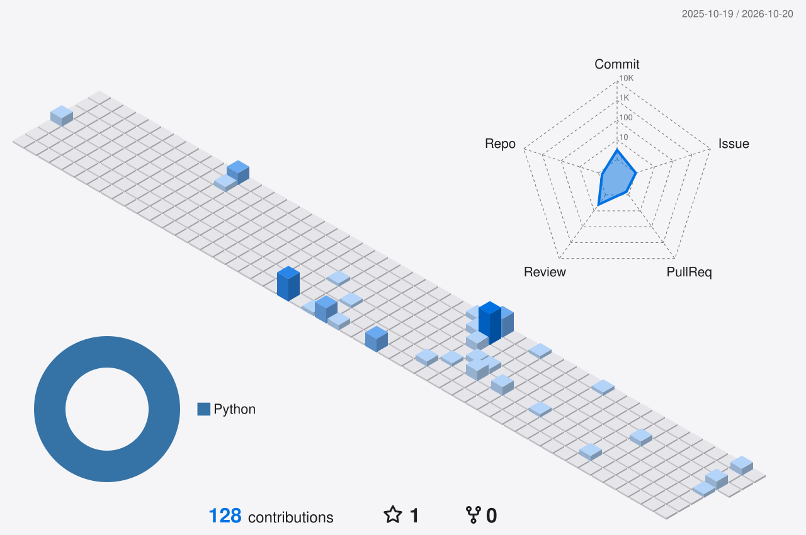
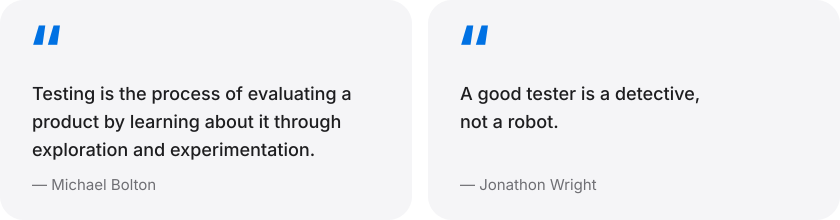

<!-- ===================== HERO ===================== -->

  <picture>
    <source media="(prefers-color-scheme: dark)" srcset="assets/hero-dark.svg" />
    
  </picture>

 

<!-- ===================== ABOUT (bento grid) ===================== -->

  <picture>
    <source media="(prefers-color-scheme: dark)" srcset="assets/about-dark.svg" />
    
  </picture>

 

<!-- ===================== TOOLS ===================== -->
<h3 align="center">Toolkit</h3>

  <picture>
    <source media="(prefers-color-scheme: dark)" srcset="assets/toolkit-dark.svg" />
    
  </picture>

  <picture>
    <source media="(prefers-color-scheme: dark)" srcset="assets/chips-dark.svg" />
    
  </picture>

 

<!-- ===================== STATS ===================== -->
<h3 align="center">GitHub Activity</h3>

  <picture>
    <source media="(prefers-color-scheme: dark)"
            srcset="https://github-readme-stats.vercel.app/api?username=damosman&count_private=true&show_icons=true&hide_border=true&border_radius=20&bg_color=1C1C1E&title_color=F5F5F7&text_color=A1A1A6&icon_color=2997FF" />
    
  </picture>
  <picture>
    <source media="(prefers-color-scheme: dark)"
            srcset="https://github-readme-stats.vercel.app/api/top-langs/?username=damosman&layout=compact&hide_border=true&border_radius=20&bg_color=1C1C1E&title_color=F5F5F7&text_color=A1A1A6" />
    
  </picture>

  <picture>
    <source media="(prefers-color-scheme: dark)"
            srcset="https://github-readme-streak-stats.herokuapp.com?user=damosman&hide_border=true&border_radius=20&background=1C1C1E&ring=2997FF&fire=2997FF&currStreakNum=F5F5F7&currStreakLabel=2997FF&sideNums=F5F5F7&sideLabels=A1A1A6&dates=A1A1A6&stroke=3A3A3C" />
    
  </picture>

  <picture>
    <source media="(prefers-color-scheme: dark)"
            srcset="https://github-readme-activity-graph.vercel.app/graph?username=damosman&hide_border=true&radius=20&bg_color=1C1C1E&color=A1A1A6&line=2997FF&point=F5F5F7&area=true&area_color=2997FF" />
    
  </picture>

 

<!-- ===================== GRAPHS (rebuilt nightly by .github/workflows/profile-graphs.yml) ===================== -->
<h3 align="center">Contributions in 3D</h3>

  <picture>
    <source media="(prefers-color-scheme: dark)" srcset="profile-3d-contrib/graph-3d-dark.svg" />
    
  </picture>

  <picture>
    <source media="(prefers-color-scheme: dark)" srcset="assets/graphs/snake-dark.svg" />
    
  </picture>

 

<!-- ===================== QUOTES ===================== -->

  <picture>
    <source media="(prefers-color-scheme: dark)" srcset="assets/quotes-dark.svg" />
    
  </picture>

